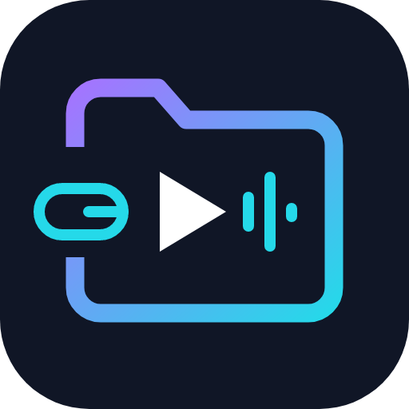
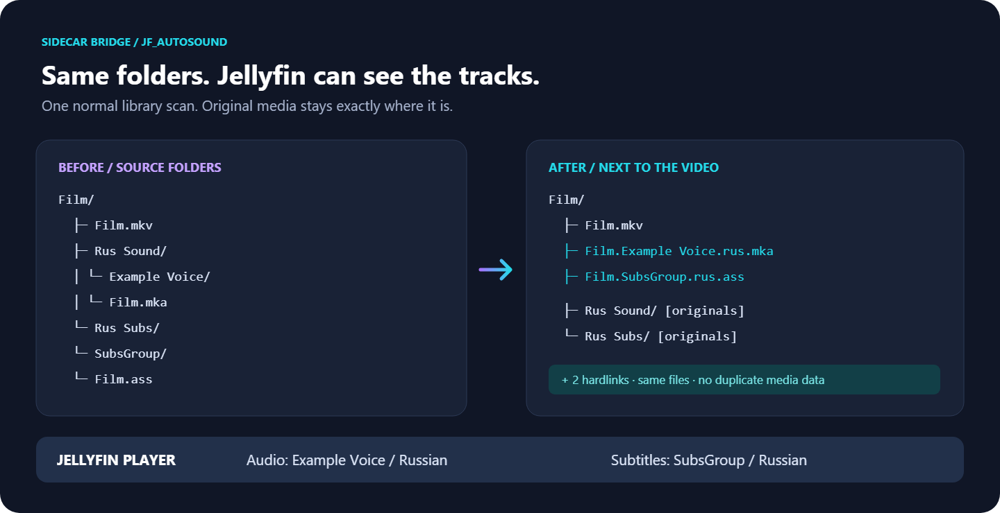
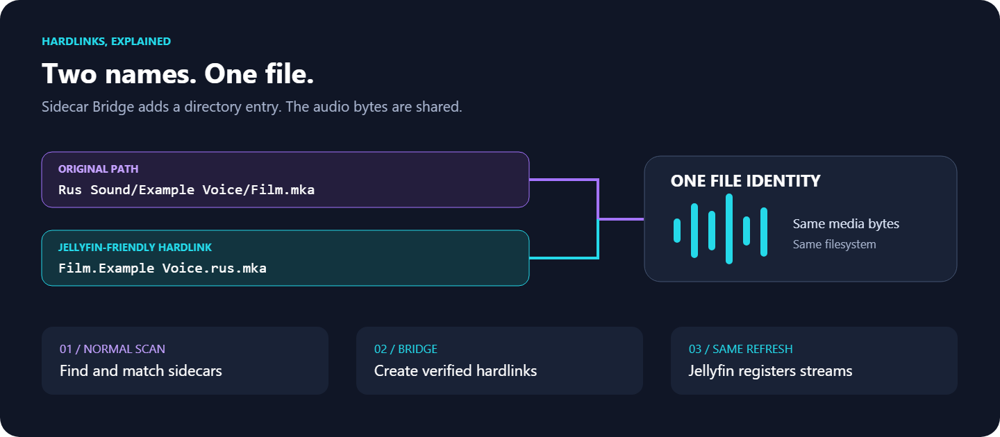

# jf_AutoSound · Sidecar Bridge

**A Jellyfin plugin that finds external audio and subtitles in nested folders and creates correctly named hardlinks beside the video.** Add your media, run a normal library scan, choose the tracks in Jellyfin. Original files stay in place. No media copying, remuxing or transcoding.

[Русский](README.ru.md) · [Installation](docs/installation.md) · [Configuration](docs/configuration.md) · [Test evidence](docs/verification.md)



## A simple example

Your files:

```text
Film/
├── Film.mkv
├── Rus Sound/NDA Studio/Film.mka
└── Rus Subs/SubsGroup/Film.ass
```

Sidecar Bridge adds two names next to the video:

```text
Film/
├── Film.mkv
├── Film.NDA Studio.rus.mka     ← hardlink to the original audio
├── Film.SubsGroup.rus.ass      ← hardlink to the original subtitles
├── Rus Sound/NDA Studio/Film.mka
└── Rus Subs/SubsGroup/Film.ass
```

Jellyfin's player can now list **NDA Studio / Russian** and **SubsGroup / Russian**. These are illustrative labels; embedded metadata and the client can affect the displayed title.

The same layout works with `Video/Film.mkv` and sibling `Audio/`, `Subs/`, `Subtitles/`, `RUS Sound [Studio]/` or `Rus Subs [Group]/` folders. Paths come from Jellyfin libraries. Downloads can arrive through SMB, a torrent client or a manual copy.



## What it does

- Handles MKV/MP4 video, MKA audio and ASS/SSA/SRT/VTT subtitles.
- Matches exact names first, then safe normalization, then an unambiguous work/season/episode/type/edition key. `TV 01`, `Sp 01` and `Sp 00` stay distinct.
- Keeps multiple studios and languages separate. Language comes from an explicit filename suffix, a directory prefix or a configured rule. Unknown stays undefined.
- Creates only hardlinks. A different filesystem, missing permission or unsupported filesystem produces a report, with no copy/symlink fallback.
- Rechecks later additions, handles owned links when a source is replaced and refuses to overwrite other files.
- Provides an administrator settings page, a read-only preview and a bounded recent report.

The plugin runs inside Jellyfin. It does not need a daemon, watcher, container sidecar, cron job, downloader integration, external runtime script, cloud service or account. It never queues another metadata refresh or scan. Jellyfin's own media analysis and playback work normally.

## Start here

Target: **Jellyfin 12.4.0 / .NET 10**. Use the ZIP from a successful CI artifact, or build it locally. A public GitHub Release has deliberately not been published; `manifest.json` has no published versions yet.

1. Stop Jellyfin and extract the installation ZIP into a new `SidecarBridge_0.1.0.0` folder under its plugins directory.
2. Start Jellyfin. Open Dashboard → Plugins → Sidecar Bridge.
3. Enable the required libraries, audio and/or subtitles. Save. All libraries start disabled.
4. Try **Preview** with a full video path as seen by the server, then run a normal library scan.

The default 30-second file-age guard defers very recent files until the next ordinary scan. Files must be readable and destination directories writable, on the same filesystem. See [installation](docs/installation.md) for Linux, Docker and Windows.

## Build and test

Install the SDK pinned in `global.json`, plus Python 3 for packaging/test tooling:

```sh
dotnet restore src/Jellyfin.Plugin.SidecarBridge --locked-mode
dotnet restore tests/SidecarBridge.Tests --locked-mode
dotnet build src/Jellyfin.Plugin.SidecarBridge -c Release --no-restore
dotnet test tests/SidecarBridge.Tests -c Release --no-restore
python tools/package.py
```

The ZIP appears in `artifacts/SidecarBridge_0.1.0.0.zip`. Plugin runtime is entirely C#; Python and FFmpeg are development/test tools only. [Real-server tests](tests/integration/README.md) generate their own tiny media and inspect Jellyfin `MediaStreams` after a single scan.

## Compatibility and limits

| Environment | Status |
| --- | --- |
| Windows x64, local NTFS, Jellyfin 12.4 | Core and real-server scan tests passed locally |
| Linux x64 / ARM64 | Native filesystem tests and installation-ZIP real-server tests passed on both architectures; see [evidence](docs/verification.md) |
| Docker | Same plugin; needs writable media and a single filesystem/mount for source and destination; deployment not tested locally |
| SMB/NFS, mergerfs, unusual filesystems | No general compatibility claim; hardlink and identity semantics must be checked on the actual mount |
| Other Jellyfin versions, macOS | Unsupported in this version |

A hardlink shares file contents: editing through either name edits the same file. The plugin does not repair sync or differences between cuts. Multi-stream MKA files keep their embedded per-stream metadata; a filename cannot rename each stream. Reserved words in studio titles need reversible escaping because Jellyfin 12.4 recognizes some flags by substring. See [naming](docs/configuration.md#titles-languages-and-flags), [architecture](docs/architecture.md) and [limits](docs/limitations.md).

MIT. Original icon and explanatory diagrams are included as editable SVG and PNG. This is an independent plugin, not an official Jellyfin project.
