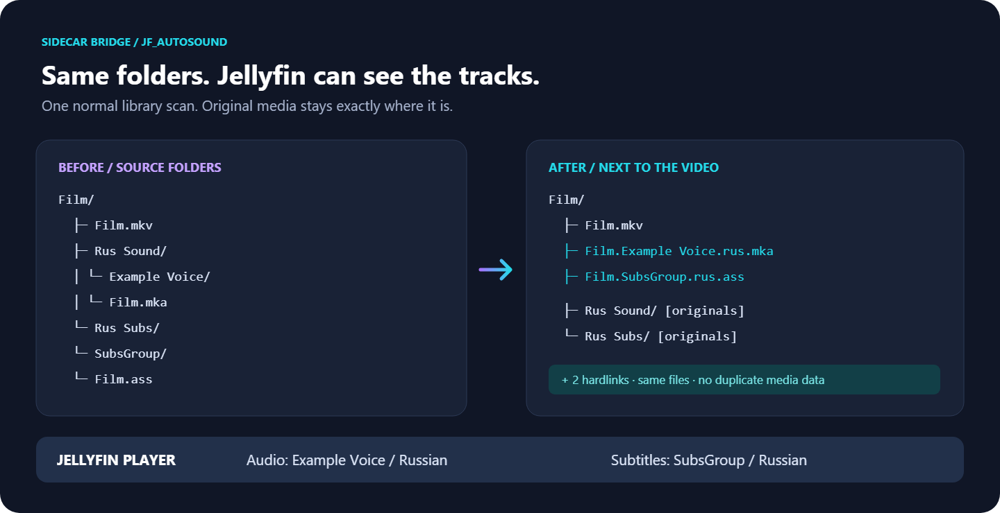
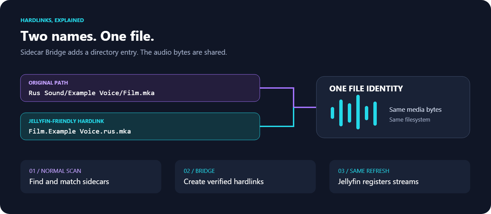

# jf_AutoSound · Sidecar Bridge

**Плагин Jellyfin, который находит озвучки и субтитры в подпапках раздачи и создаёт рядом с видео hardlinks с понятными Jellyfin именами.** Добавили файлы → обычное сканирование библиотеки → дорожки появились в проигрывателе. Оригиналы остаются на месте. Копирования медиа, remux и перекодирования нет.

[English](README.md) · [Установка](docs/installation.md) · [Настройки](docs/configuration.md) · [Что проверено](docs/verification.md)



## Было

```text
Youjo Senki/
├── Youjo Senki TV 01 серия.mkv
├── Youjo Senki TV 02 серия.mkv
├── Youjo Senki TV Sp 00 серия.mkv
├── Youjo Senki TV Sp 01 серия.mkv
├── Rus Sound/
│   └── NDA Studio/
│       ├── Youjo Senki TV 01 серия.mka
│       └── Youjo Senki TV Sp 01 серия.mka
└── Rus Subs/
    └── SubsGroup/
        └── Youjo Senki TV 01 серия.ass
```

## Что добавится рядом с видео

```text
Youjo Senki TV 01 серия.NDA Studio.rus.mka
Youjo Senki TV 01 серия.SubsGroup.rus.ass
Youjo Senki TV Sp 01 серия.NDA Studio.rus.mka
```

Это дополнительные имена существующих файлов. Второй копии озвучки или субтитров на диске нет. В Jellyfin появятся внешние дорожки с языком и названием студии. Итоговая подпись зависит также от встроенных тегов и клиента.

`TV 01` не смешивается с `Sp 01`. Нулевой спецвыпуск `Sp 00` допустим. Для второй серии и `Sp 00` в примере нет внешних дорожек — плагин ничего к ним не подставит.

## Ещё один обычный случай

```text
Film/
├── Video/Film.mkv
├── English Audio/Studio/Film.mka
└── Subtitles/Group/Film.srt
```

Рядом с `Video/Film.mkv` появятся `Film.Studio.eng.mka` и `Film.Group.srt`. У субтитров язык останется неопределённым: папка `Subtitles` его не задаёт. Можно указать язык в настройках. Русский язык всем файлам автоматически не назначается.



## Как пользоваться

Целевая версия: **Jellyfin 12.4.0, .NET 10**.

1. Остановите Jellyfin. Распакуйте установочный ZIP в новую папку `SidecarBridge_0.1.0.0` внутри каталога плагинов.
2. Запустите сервер и откройте Dashboard → Plugins → Sidecar Bridge.
3. Выберите библиотеки, включите озвучки и/или субтитры, сохраните настройки.
4. Проверьте план кнопкой Preview и запустите обычное сканирование библиотеки.

Изначально библиотеки выключены. Поддерживаются MKV/MP4, MKA, ASS/SSA/SRT/VTT. Встроенные правила понимают `Audio`, `Sound`, `Subs`, `Subtitles`, языковые префиксы и названия студий в скобках. Для нестандартных структур есть правила каталогов и явные соответствия.

Недавно записанные файлы по умолчанию откладываются до следующего обычного прохода: минимальный возраст — 30 секунд. Источник и ссылка должны находиться на одной файловой системе. Jellyfin нужны права чтения исходников и записи в каталог видео. Если hardlink создать нельзя, причина будет в отчёте; копирование или symlink вместо него не используются.

Плагин работает внутри Jellyfin. Отдельные скрипты, контейнеры, cron и привязка к qBittorrent не нужны. Повторное сканирование после создания ссылок не запускается: используется штатный анализатор Jellyfin в текущем обновлении.

## Проверки и сборка

На Windows x64, Linux x64 и Linux ARM64 прошли проверки ядра и установка ZIP в настоящий Jellyfin: дорожки в `MediaStreams` за один scan, новая озвучка у старого видео, замена исходника, повторный проход, флаги, MKA с несколькими потоками и запрет анонимного доступа к диагностике. Отдельно проверены права файловой системы и отказ hardlink между файловыми системами на Linux. Результаты — в [отчёте](docs/verification.md) и GitHub Actions. Docker и сетевые хранилища на рабочем сервере не проверялись.

```sh
dotnet restore src/Jellyfin.Plugin.SidecarBridge --locked-mode
dotnet restore tests/SidecarBridge.Tests --locked-mode
dotnet build src/Jellyfin.Plugin.SidecarBridge -c Release --no-restore
dotnet test tests/SidecarBridge.Tests -c Release --no-restore
python tools/package.py
```

Нужны SDK из `global.json` и Python 3 для упаковки. Результат: `artifacts/SidecarBridge_0.1.0.0.zip`. Python и генерация тестовых медиа не участвуют в работе установленного плагина.

Публичный GitHub Release не опубликован. Установочный ZIP готовится локально и в CI; каталог `manifest.json` пока не содержит опубликованных версий. Рабочий сервер и реальная медиатека при разработке не менялись.

Подробности: [Linux, Docker, Windows](docs/installation.md), [языки и флаги](docs/configuration.md), [интеграция в сканирование](docs/architecture.md), [ограничения](docs/limitations.md). Лицензия GPL-2.0-or-later. Иконка и две схемы входят в исходники как SVG и PNG.
